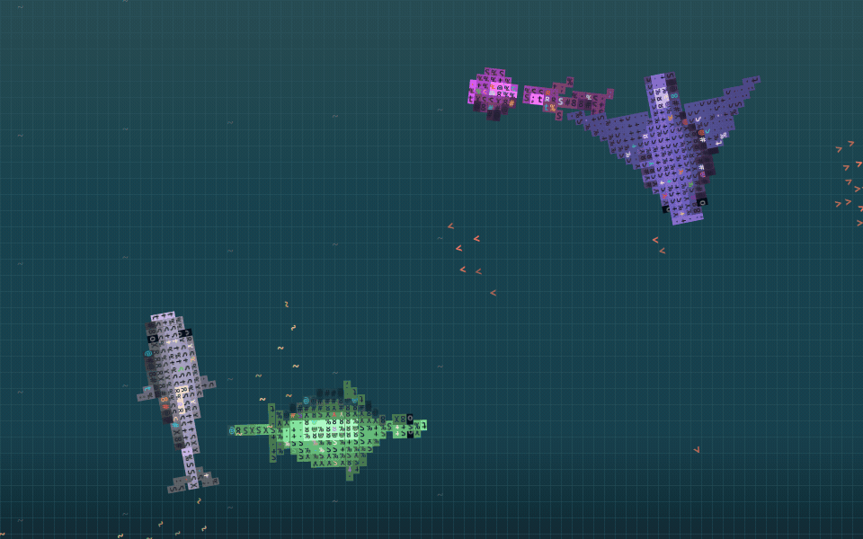

# Laut ASCII (plasma-ascii-ocean)

Wallpaper animasi ASCII bertema laut malam tampak atas (top-down) untuk KDE Plasma 6. Diverifikasi pada Wayland; X11 belum diuji.



ID Paket: `org.local.lautascii`  
Lisensi: MIT

---

## Arsitektur & Portabilitas Platform

- **`engine.mjs`**: Modul JavaScript ECMAScript murni (pure ES). Tidak memuat modul bawaan browser (`window`/`document`) maupun modul Qt. Logika matematika dan simulasi dapat dijalankan pada lingkungan JavaScript standar apa pun (Node.js, Deno, Bun, QML JS engine).
- **`Ocean.qml`**: Komponen visual murni berbasis `QtQuick` (Canvas, Text, Timer). Tidak bergantung pada modul spesifik KDE Plasma.
- **`DesktopVisibility.qml` & `main.qml`**: Pembungkus integrasi wallpaper Plasma 6. Mengisolasi ketergantungan modul KDE (`org.kde.plasma.plasmoid`, `org.kde.taskmanager`).
- **Pratinjau Mandiri (`preview.qml`)**: Hanya membutuhkan `QtQuick` dan `QtQuick.Controls` (Qt 6). Dapat dijalankan langsung tanpa modul atau desktop KDE terpasang.
- **Portabilitas Lintas Platform**: Secara desain, jendela pratinjau (`preview.qml`) portabel dan dapat dibuka di sistem operasi lain (seperti macOS atau Windows) asalkan Qt 6 (`qml6`) tersedia, namun **belum diuji** pada platform tersebut. Sebagai wallpaper desktop native terintegrasi, proyek ini **hanya ditujukan dan diverifikasi untuk KDE Plasma 6 (Wayland)**. Tidak ada klaim dukungan wallpaper native di luar Plasma 6.

---

## Fitur

- **Bioma Laut ASCII**: Simulasi hewan laut (pari manta, penyu, paus, ubur-ubur, hiu martil, hiu macan, hiu mako, hiu thresher) dengan kuota terbatas (bounded animal count) yang berotasi berkala, kawanan ikan kecil berwarna-warni, hujan, gelombang permukaan organik, serta awan berlapis kerapatan karakter ASCII tembus pandang via native Qt Quick `Text` (opsi `externalClouds`, bukan siluet oval polos).
- **Tanpa Jam**: Tampilan bersih khusus panorama laut malam tanpa widget jam bawaan.
- **Auto-Pause Cerdas**: Simulasi otomatis membeku (freeze) hanya saat ada jendela aplikasi aktif dan tampak pada virtual desktop / activity saat ini. Jendela yang diminimalkan atau tersembunyi diabaikan, dan mode "Show Desktop" secara otomatis mengesampingkan (override) jeda sehingga animasi kembali berjalan. Pada jendela pratinjau (`preview.qml`), fitur auto-freeze dinonaktifkan agar tetap dapat ditinjau bebas.
- **Mandiri & Terintegrasi**: Berjalan sebagai paket wallpaper Plasma 6 native menggunakan Qt Quick / QML dan modul JavaScript ES tanpa memerlukan build step kompilasi.

---

## Batasan & Performa Hardware

- **Bukan Zero-Copy / Zero CPU**: Render grafis menggunakan Qt Quick `Canvas` (konteks 2D). Canvas Qt melakukan operasi rasterisasi teks glyph ASCII yang membutuhkan siklus CPU/GPU secara wajar. Jumlah hewan dibatasi agar beban pemrosesan tetap stabil, namun klaim *60 FPS konstan tanpa beban CPU* atau *zero-copy memory* tidak berlaku secara teknis.
- **Variasi Performa**: Kecepatan frame riil bergantung pada resolusi layar, frekuensi render, dan kapabilitas hardware masing-masing perangkat.
- **Privasi & Keamanan**: Tanpa akses jaringan/internet, tanpa pelacakan telemetri, dan tanpa penangkapan kursor mouse global di luar area kanvas wallpaper desktop.

### Hasil pengukuran lokal

Sampel CachyOS, Wayland, 12 logical CPU. Angka berikut bukan jaminan untuk perangkat lain.

| Kondisi / metrik | Hasil terukur |
| --- | --- |
| Render Qt Canvas, viewport 1920×1150 | rata-rata 39,3 ms; p95 49 ms |
| Penyelesaian gambar, target 30 FPS | 7,46 gambar/detik selama 6,17 detik |
| Plasma saat wallpaper aktif (sampel 5 detik) | 79,0% satu logical CPU; 6,58% kapasitas 12 logical CPU |
| Plasma saat auto-freeze stabil (sampel 10 detik) | 0,10% satu logical CPU; RSS 375,3 MiB |

CPU/RAM adalah **seluruh proses plasmashell**, termasuk panel dan widget. Renderer membatasi antrean dan memberi jeda setelah menggambar; target FPS bisa tidak tercapai. Wallpaper bergerak ini masih memakan daya saat aktif. Untuk baterai, biarkan auto-freeze menyala atau gunakan wallpaper statis. Kabut memakai teks native yang disimpan, bentuk hewan diklasifikasikan sekali lalu mengikuti tulang belakang, bukan dihitung ulang per sel layar setiap frame.

---

## Persyaratan Sistem

- KDE Plasma 6 (Wayland diverifikasi; X11 belum diuji)
- Qt 6 Quick / Kirigami / Plasma Framework
- Perkakas paket Plasma: `kpackagetool6` (biasanya dari paket `kpackage` atau `plasma-workspace`)
- *(Opsional)* `qml6` untuk menjalankan jendela pratinjau mandiri (`preview.qml`) atau pengujian benchmark render
- *(Opsional)* Node.js (v22+) untuk menjalankan uji logika engine (`checks/fish-check.mjs`) atau pemantau memori/CPU (`checks/usage.mjs`)

---

## Pemasangan (Installation)

Pastikan paket `kpackagetool6` terpasang di sistem Anda. Buka terminal pada direktori proyek hasil unduhan/ekstraksi:

```bash
# Pasang paket wallpaper via kpackagetool6
kpackagetool6 --type Plasma/Wallpaper --install ./package
```

### Mengaktifkan Wallpaper di Plasma 6

1. Klik kanan pada desktop Plasma Anda, lalu pilih **Configure Desktop and Wallpaper...** (Konfigurasi Desktop dan Wallpaper).
2. Pada dropdown **Wallpaper Type** (Jenis Wallpaper), pilih **Laut ASCII**.
3. Sesuaikan opsi tampilan (pilihan hewan, efek hujan, ombak, awan ASCII, dan interaksi mouse).
4. Klik **Apply**.

---

## Pembaruan (Upgrade) & Refresh Aman

Untuk memperbarui wallpaper ke versi atau kode terbaru:

```bash
# Perbarui paket terpasang via kpackagetool6
kpackagetool6 --type Plasma/Wallpaper --upgrade ./package
```

Saat memperbarui berkas kode wallpaper, **tidak perlu menghapus berkas cache sistem atau mematikan/restart plasmashell**.

Langkah penyegaran aman via antarmuka (UI):
1. Buka kembali **Configure Desktop and Wallpaper...**.
2. Ganti **Wallpaper Type** sementara ke **Image** (Gambar biasa) lalu klik **Apply**.
3. Tunggu 2–3 detik agar instance wallpaper lama dilepas dari memori.
4. Ganti kembali **Wallpaper Type** ke **Laut ASCII** lalu klik **Apply**.

---

## Pencopotan (Removal)

1. Ganti wallpaper desktop ke wallpaper standar (misalnya **Image**) melalui menu pengaturan Plasma terlebih dahulu.
2. Hapus paket wallpaper menggunakan `kpackagetool6`:

```bash
kpackagetool6 --type Plasma/Wallpaper --remove org.local.lautascii
```

---

## Pengujian & Tolok Ukur Mandiri

### 1. Uji Logika Engine (Node.js)
Jalankan verifikasi spesifikasi hewan dan siklus simulasi:

```bash
node checks/fish-check.mjs
```

### 2. Pratinjau Mandiri Tanpa Memasang ke Desktop (Qt 6)
Jalankan pratinjau mandiri dengan runtime QML (fitur auto-freeze dinonaktifkan di sini):

```bash
qml6 preview.qml
```

### 3. Tolok Ukur Render Qt (Native Canvas Benchmark)
Pemeriksaan laju render Qt Canvas aktual:

```bash
qml6 checks/benchmark.qml
```
*Catatan:* Angka ini mengukur penyelesaian `Canvas.painted` dalam runtime Qt, bukan refresh rate/scanout monitor. Pengukuran memakai renderer produksi. Jalankan saat wallpaper desktop sedang auto-freeze agar beban tidak berganda.

### 4. Uji Regresi Siklus Hidup Qt QML
Pemeriksaan siklus hidup visual dan regresi komponen QML:

```bash
qml6 checks/ocean-check.qml
```

### 5. Pemantauan Beban CPU & Memori (`/proc`)
Uji pemantauan read-only terhadap proses `plasmashell` melalui sampler Linux `/proc` (misalnya selama 10 detik):

```bash
node checks/usage.mjs 10
```
Skrip ini menghitung penggunaan CPU (pada satu core vs seluruh logical CPU) serta Resident Set Size (RSS) dari keseluruhan proses `plasmashell`.

---

## Pemecahan Masalah & Log

Jika output log Qt tidak muncul di terminal atau journal, aktifkan penulisan log langsung ke stderr:

```bash
export QT_FORCE_STDERR_LOGGING=1
```

Pantau log plasmashell melalui systemd journal:

```bash
# Pantau log plasmashell secara realtime
journalctl -f --user -u plasma-plasmashell

# Atau filter pesan terkait modul wallpaper
journalctl --user -b -g "lautascii"
```

Pastikan instalasi terdaftar dengan menjalankan:

```bash
kpackagetool6 --type Plasma/Wallpaper --list
```

---

## Kontribusi & Ucapan Terima Kasih

Kontribusi, perbaikan bug, atau penyempurnaan fitur dipersilakan melalui pull request atau laporan masalah (issue). Harap jaga kode tetap ringkas, mandiri tanpa dependensi berat, dan patuhi standar Plasma 6 QML.

Proyek ini menggunakan logika simulasi yang diadaptasi dari [ascii-sharks](https://github.com/stackedlol/ascii-sharks) karya drewdi (revisi commit `a0074c16a106f0abc665fe9712ca445f8f98ad8e`). Rincian lisensi pihak ketiga dapat dibaca pada berkas [THIRD_PARTY_NOTICES.md](THIRD_PARTY_NOTICES.md).
